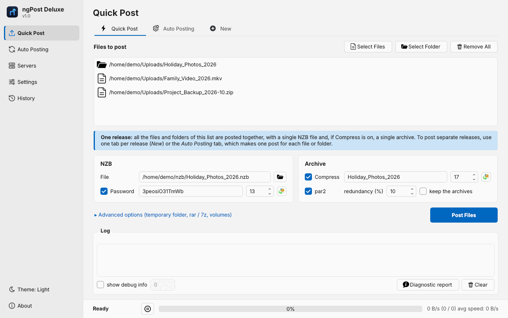
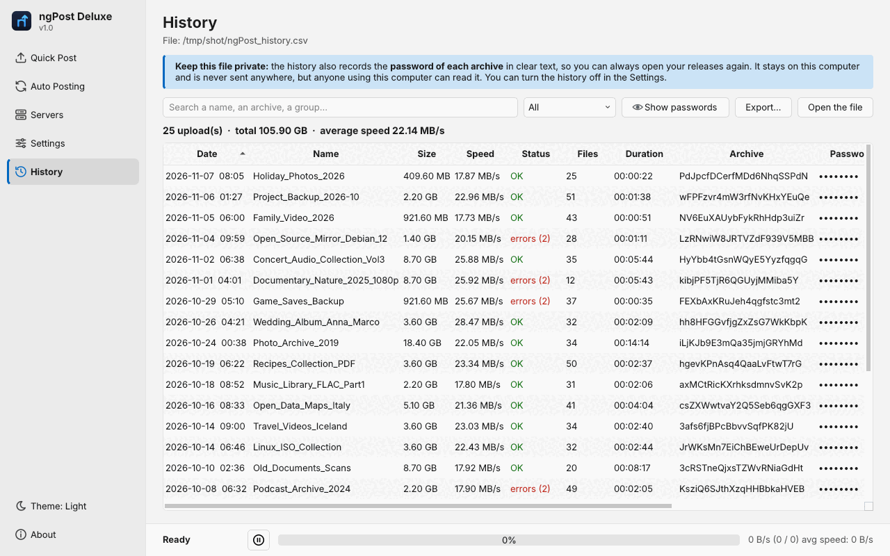
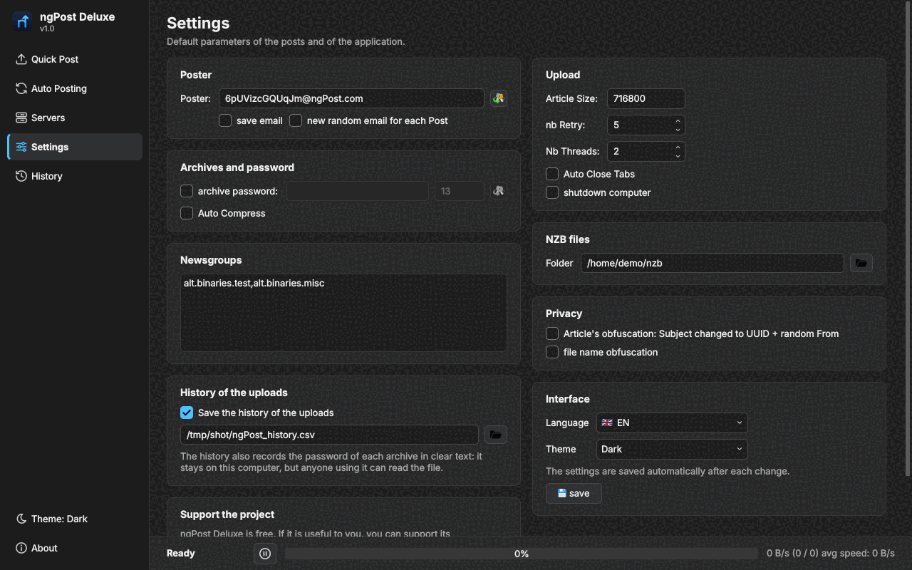
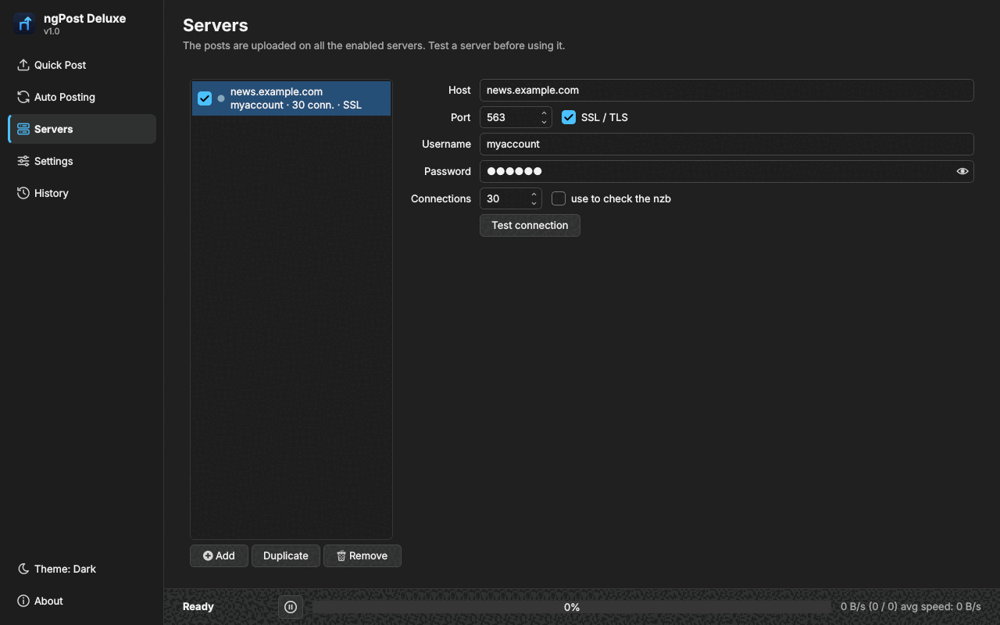

# ngPost Deluxe

[English](README.md) | **Français** | [Deutsch](README_DE.md) | [Italiano](README_IT.md) | [Español](README_ES.md) | [Nederlands](README_NL.md) | [Português](README_PT.md) | [中文](README_ZH.md)

**ngPost Deluxe** est une version revisitée et redessinée du célèbre uploader Usenet **ngPost**. 
C'est un fork de [mbruel/ngPost](https://github.com/mbruel/ngPost) (v4.16, licence GPL v3). Tout le mérite du programme original revient à son auteur, Matthieu Bruel. 

### Téléchargement
**Installateur** : téléchargez `ngPostDeluxe-v1.0-win64-setup.exe` (Windows 64 bits) ou `ngPostDeluxe-v1.0-win32-setup.exe` (Windows 32 bits) sur la page [Releases](https://github.com/thenormal/ngPost-Deluxe/releases/latest) et suivez les étapes. [7-Zip](https://www.7-zip.org/) est inclus : il n'y a rien d'autre à installer. Vos paramètres et l'historique sont conservés dans `%APPDATA%\ngPost Deluxe` et survivent aux mises à jour et à la désinstallation. 
Windows peut afficher « Windows a protégé votre ordinateur » car l'installateur n'est pas signé numériquement : cliquez sur **Informations complémentaires**, puis **Exécuter quand même**. 
**Version portable** : `ngPostDeluxe-v1.0-win64.zip` / `ngPostDeluxe-v1.0-win32.zip`, sans installation : décompressez le dossier où vous voulez et lancez `ngPostDeluxe.exe` (les paramètres sont dans le `ngPost.conf` à côté du programme).

### Captures d'écran
| Quick Post (thème clair) | Historique |
|---|---|
|  |  |
| **Paramètres (thème sombre)** | **Serveurs (thème sombre)** |
|  |  |

### Ce qui change dans ce fork
-   **Correctif de sécurité**: dépassement de mémoire possible dans le tampon d'encodage yEnc (la sortie pouvait être plus grande que le tampon avec certaines données)
-   **Correctif yEnc**: un espace ou une tabulation en fin de ligne est maintenant correctement échappé (certains serveurs le supprimaient, ce qui corrompait les données)
-   **Mots de passe plus sûrs**: les mots de passe et noms d'archives générés utilisent le générateur aléatoire cryptographique du système (Qt >= 5.10) à la place de `std::rand()`
-   **NZB_POST_CMD**: les variables peuvent contenir des espaces (un chemin comme `C:\Mes dossiers\fichier.nzb` reste UN SEUL argument) et la commande est lancée en arrière-plan (ngPost ne l'attend plus, son code de retour n'est donc plus affiché)
-   **RAR_EXTRA et PAR2_ARGS**: analysés en respectant les guillemets. 7-Zip est détecté d'après le nom du programme et non d'après tout le chemin
-   **ParPar** (un générateur de par2 bien plus rapide) est fourni pour Windows 64bit (v0.4.6, domaine public) et utilisé automatiquement quand `parpar.exe` est dans le dossier de ngPost. par2cmdline 64bit a été retiré du package, la version 32bit est conservée pour Windows 32bit
-   **Nouvelle interface** : barre latérale (Quick Post, Post Auto, Serveurs, Paramètres, Historique), pages en cartes, options avancées masquées tant qu'elles ne servent pas, une nouvelle icône et un écran vide qui explique quoi faire. **Thèmes clair et sombre**, ou automatique comme Windows (clé `theme`). Définissez la variable d'environnement `NGPOST_NO_THEME` pour retrouver l'apparence native
-   **Interface en italien**: l'interface graphique et la ligne de commande sont maintenant aussi traduites en italien (déjà disponibles en allemand, anglais, chinois, espagnol, français, néerlandais et portugais)
-   **Nouveau README**: réécrit pour ce fork et disponible en 8 langues (anglais, français, allemand, italien, espagnol, néerlandais, portugais, chinois)
-   **ngPost Deluxe v1.0** : nouveau nom et nouvelle version (le programme Windows s'appelle maintenant `ngPostDeluxe.exe` ; le fichier de configuration ne change pas), fenêtre À propos redessinée, les boutons de don d'origine sont remplacés par un bouton **Ko-fi** pour ce fork (dans la fenêtre À propos et dans les Paramètres)
-   **Installateur Windows** (64 bits et 32 bits, avec **7-Zip inclus**) et paquets ZIP portables, construits automatiquement sur GitHub et publiés dans les Releases (`ngPostDeluxe.exe`)
-   **Compression plus rapide sous Windows** : la sortie de 7-Zip / rar est maintenant lue au fur et à mesure (un post de 115 Mo attendait 200 s avant, 1 s maintenant)
-   **Nouvelle section Serveurs** : liste des serveurs avec un voyant d'état et une case activé/désactivé, fiche de détail (mot de passe affiché à la demande) et un bouton **Tester la connexion** qui vérifie l'identification. Modifier les serveurs pendant un envoi ne peut plus faire planter ngPost
-   **Enregistrement automatique** : chaque modification des réglages est enregistrée automatiquement (le fichier précédent est conservé en `ngPost.conf.bak`)
-   **Onglet Auto Posting** : nouveaux boutons **Retirer les terminés**, **Tout retirer** et **Fermer les onglets terminés**
-   **Mot de passe de l'archive hors de la ligne de commande** : 7-Zip le reçoit sur son entrée standard et rar par la variable d'environnement `RAR`, il n'apparaît donc plus dans la liste des processus
-   **Diagnostic** : ngPost enregistre la durée et la vitesse de chaque phase (compression, par2, envoi), les erreurs et les blocages, et le bouton **Rapport de diagnostic** enregistre un rapport pour analyser un problème. Mots de passe, identifiants et noms de fichiers sont masqués, rien n'est envoyé
-   **Windows** : la fenêtre de console se ferme d'elle-même quand ngPost est lancé par un double clic ; le paquet contient OpenSSL 1.1.1w (dernière version supportée par Qt 5)
-   **Page Historique** : chaque upload est enregistré (`ngPost_history.csv` à côté de la configuration, ou `POST_HISTORY`) avec son statut, le nombre de fichiers et la durée. La page les liste avec recherche, filtre par période, totaux, mots de passe masqués jusqu'à la demande, copie, export et dossier du NZB. Attention : le fichier contient les mots de passe des archives en clair
-   **Quick Post** : une note rappelle que tous les éléments de la liste sont postés comme une seule release (un NZB, une archive)

Il n'y a pas encore de version officielle de ce fork. Un paquet **Windows 64bit** prêt à l'emploi est construit automatiquement par GitHub Actions à chaque modification (onglet *Actions* > exécution *Build Windows (x64)* > *Artifacts*, un compte GitHub est nécessaire). Sur les autres systèmes, compilez-le depuis les sources (voir ci-dessous). 

### Fonctionnalités principales
-   **Posteur Usenet en ligne de commande et avec interface graphique** pour les binaires, développé en **C++11/Qt5** et conçu pour être le plus rapide possible
-   **compresse** (avec votre rar/7zip externe) et **génère les par2** avant de poster
-   dispose d'une **file d'attente** et **prépare le post suivant pendant l'upload du courant**
-   **automatise les posts**: scanne ou surveille des dossiers et poste chaque nouveau fichier/dossier individuellement (nom d'archive et mot de passe aléatoires possibles)
-   **obfusque les en-têtes des Articles**: poster aléatoire et sujet en UUID, un post ne se retrouve qu'avec le fichier nzb
-   **génère le fichier nzb** et écrit un **historique des posts** au format csv (nom d'archive et mot de passe inclus)
-   peut **supprimer les fichiers une fois postés**, **exécuter une commande ou un script** après chaque post (NZB_POST_CMD) et **éteindre l'ordinateur**
-   traduit en **allemand, anglais, chinois, espagnol, français, italien, néerlandais et portugais**

### Mots-clés de configuration modifiés dans ce fork
Le fichier de configuration fonctionne comme dans le projet original (par défaut: **~/.ngPost** sous Linux et Mac, **ngPost.conf** dans le dossier d'installation sous Windows). Seuls les mots-clés dont le comportement a changé sont listés ici:

- **NZB_POST_CMD**: commande exécutée après chaque post. Les variables peuvent contenir des espaces et la commande est lancée en arrière-plan (son code de retour n'est pas enregistré)
- **RAR_EXTRA**: pour personnaliser la commande rar (inutile de préciser 'a', '-idp' ou '-r'). Inutile pour 7-zip, sauf pour changer le niveau de compression. Respecte maintenant les guillemets.
- **PAR2_CMD**: pour changer le générateur de par2 et pouvoir utiliser [Parpar](https://github.com/animetosho/ParPar) ou [Multipar](http://hp.vector.co.jp/authors/VA021385/). (ParPar est utilisé automatiquement sous Windows 64bit si `parpar.exe` est dans le dossier de ngPost; par2cmdline reste le choix par défaut ailleurs)
- **PAR2_ARGS**: pour personnaliser la commande par2, surtout si vous choisissez un programme différent de celui par défaut. Respecte maintenant les guillemets.
- **theme** : thème de l'interface, `AUTO` (comme Windows), `LIGHT` ou `DARK`
- **history** : `ON` (par défaut) ou `OFF`, historique des uploads affiché dans la page Historique. Sans **POST_HISTORY** le fichier est `ngPost_history.csv` à côté de la configuration. De nouvelles colonnes sont ajoutées à la fin de chaque ligne : statut, nombre de fichiers, durée et fichier NZB

### Comment compiler ngPost
#### Les dépendances:
- build-essential (compilateur C++, libstdc++, make,...)
- qt5-default (librairies Qt5 et headers)
- qt5-qmake (pour générer les fichiers moc et créer le Makefile)
- libssl (v1.0.2 ou v1.1) mais devrait déjà être installée sur votre système

#### Compilation:
- allez dans le dossier **src**
- qmake
- make

C'est tout, vous devriez avoir l'exécutable **ngPost** 
vous pouvez le copier quelque part accessible dans votre PATH.

Comme ngPost est écrit en C++/Qt, vous pouvez le compiler sur tous les OS (Linux / Windows / MacOS / Android) 
Une alternative pour compiler est [d'installer Qt](https://www.qt.io/download) et de charger le projet dans QtCreator 

### Documentation complète
Les options de la ligne de commande, la liste complète des mots-clés de configuration et les guides d'installation sont ceux du projet original: voir le [README de ngPost](https://github.com/mbruel/ngPost#readme). Ses guides d'installation concernent les binaires originaux, pas ce fork.

### Licence
**ngPost** est publié sous licence **GPL v3**
<pre>
//========================================================================
//
// Copyright (C) 2020 Matthieu Bruel <Matthieu.Bruel@gmail.com>
// This file is a part of ngPost : https://github.com/mbruel/ngPost
//
// This program is free software: you can redistribute it and/or modify
// it under the terms of the GNU General Public License as published by
// the Free Software Foundation, version 3..
//
// This program is distributed in the hope that it will be useful,
// but WITHOUT ANY WARRANTY; without even the implied warranty of
// MERCHANTABILITY or FITNESS FOR A PARTICULAR PURPOSE.  See the
// GNU General Public License for more details.
//
// You should have received a copy of the GNU General Public License
// along with this program. If not, see <http://www.gnu.org/licenses/>
//
//========================================================================
</pre>

### Questions / Problèmes / Demandes
- pour toute question sur ce fork, vous pouvez contacter son mainteneur sur GitHub: [thenormal](https://github.com/thenormal)
- pour le programme original, référez-vous au [projet original](https://github.com/mbruel/ngPost) et à son auteur Matthieu Bruel

### Langues supportées
Pour l'instant ngPost est traduit en allemand, anglais, chinois, espagnol, français, italien, néerlandais et portugais (la traduction italienne a été ajoutée dans ce fork). 
Si vous souhaitez le traduire dans une autre langue, c'est très simple (Qt fournit un GUI pour cela: QtLinguist), les fichiers de traduction sont dans le dossier **src/lang**.

### Remerciements
- Matthieu Bruel (mbruel) pour avoir créé ngPost et l'avoir publié sous licence GPL v3
- Uukrull pour ses tests intensifs, ses retours et pour avoir construit tous les packages MacOS.
- awsms pour ses tests sur un vrai serveur avec une connexion de 10Gb/s qui ont permis d'améliorer la vitesse d'upload de ngPost et le support du multi-threading
- animetosho pour avoir développé ParPar, le générateur de par2 le plus rapide qui soit!
- demanuel pour le développement de NewsUP qui fut mon premier posteur
- noobcoder1983 pour la traduction allemande
- tiriclote pour la traduction espagnole
- hunesco pour la traduction portugaise
- Peng pour la traduction chinoise
- tous les utilisateurs de ngPost ;)

### Soutenir ce fork
ngPost Deluxe est gratuit. S'il vous est utile, vous pouvez soutenir son développement sur Ko-fi : 

### Soutenir l'auteur original
ngPost a été créé par Matthieu Bruel. Si vous utilisez l'application et souhaitez contribuer à l'effort, merci de le faire sur le [projet original](https://github.com/mbruel/ngPost).
